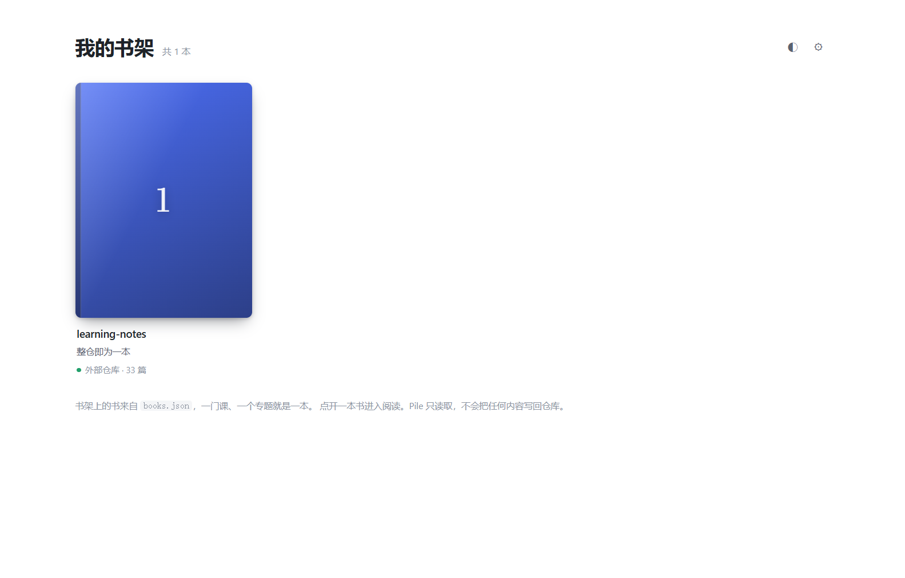
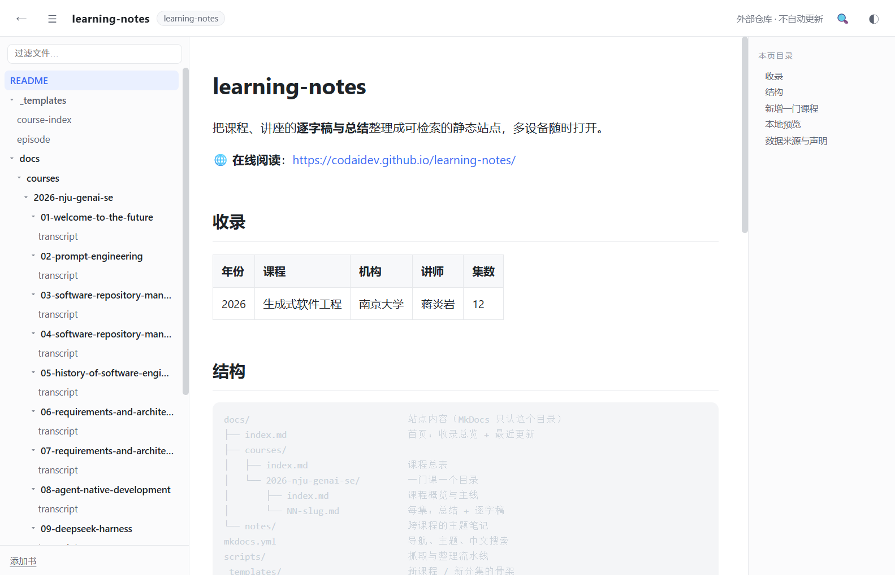

# Pile

把散落在各个 GitHub 仓库和本地文件夹里的 Markdown 笔记，收进同一个书架。

Pile 是一个 Windows 桌面阅读器：独立窗口、不依赖浏览器、自带 git。它只做两件事——把笔记聚到一处，然后好好呈现出来。它不会修改、提交或上传你的任何内容。





## 它解决什么问题

课程笔记在一个仓库、读书笔记在另一个仓库、随手写的备忘存在 `D:\notes`、某个项目的文档又在别处。想找一句话，得挨个打开编辑器、挨个 `git pull`。

Pile 把这些来源放进同一个书架：一边是远端的私有或公开仓库，一边是本地任意文件夹，读的时候都是同一个界面——左侧目录树、中间正文、右侧本页大纲，格式统一。

## 一本书 = 一个来源

打开 Pile 先看到书架，每张卡片是一本「书」，一本书背后就是一份笔记来源：

| 类型 | 是什么 | 行为 |
| --- | --- | --- |
| **托管仓库** | 填 GitHub 地址，Pile 自己克隆到程序目录 | 跟着远端更新 |
| **外部仓库** | 你已经克隆好的仓库目录（比如某个开发仓库） | 只读浏览，不自动更新，避免动你的工作副本 |
| **本地目录** | 普通文件夹，没有 git | 纯静态只读 |

## 三条设计原则

### 1. 只能看，不能改，更不会上传

不是「没做编辑功能」这么简单：代码里不存在 `commit` 和 `push`，而且每个仓库的 `pushurl` 被改成无效地址。哪天出了 bug 也推不上去，你的笔记仓库不会因为用错工具被污染。

### 2. 更新是「拉」，不是「同步」

没有双向同步那种最容易出事的机制。更新只有一个方向：`fetch` 之后快进到远端。打开一本书时，如果距上次拉取超过 5 分钟，它会自动拉一次；也可以随时点「刷新」。

如果本地那份被改过、无法快进，Pile 会先拒绝，把改动的文件列出来，让你选：取消这次更新，或者丢弃本地改动强制对齐远端。丢弃前会把改动存成 patch 放进 `data\trash\`，能找回。

### 3. 数据全在程序目录里

便携版解压就能用，数据在程序同级的 `data\`：书目、token、克隆下来的仓库、日志、浏览器缓存都在里面。整个文件夹拷到 U 盘或另一台电脑，打开还是原样——不写注册表，不往 `%APPDATA%` 扔东西。

## 还能用到这些

- **中文排版**：正文 17px、行高 1.85、宽度限制 780px，长文不累眼
- **全文搜索**：按 `/` 唤出，中文正常命中，结果带上下文片段
- **深链接**：每篇笔记有固定地址 `/read/<书的 id>/<路径>`，可以存书签
- **暗色主题**、滚动位置记忆；`j` / `k` 翻页，`Ctrl+S` 刷新
- **私有仓库**：填一个只有 `Contents: Read-only` 权限的细粒度 PAT 即可，token 用 Windows `safeStorage` 加密
- 本地服务只监听 `127.0.0.1`，不对局域网开放

## 快速开始

**免安装版**：从 [Releases](https://github.com/codaidev/pile/releases/latest) 下载 `Pile-0.2.0-win-x64.zip`，解压后双击 `Pile.exe` 就能用——不需要另外装 Node 或 git。

**从源码运行**（适合想改代码或自己打包的人，需要 Node 22+ 和 Windows）：

```bash
git clone https://github.com/codaidev/pile.git
cd pile
pnpm install
pnpm run fetch-git   # 下载并精简内嵌的 PortableGit（约 60 MB）
pnpm start
```

首次启动会弹出「添加一本书」：填仓库地址（或本地目录路径），私有仓库再补一个 token。想加更多书，编辑 `data\books.json`——那是手写的书目清单。

## 它明确不做什么

- **不编辑**：要改笔记，用你熟悉的编辑器改完提交
- **不管理书架**：书的增删目前靠手写 `books.json`，没有界面
- **不记阅读进度**：没有「上次读到哪」
- **不做多设备实时同步**：设备之间靠 git 仓库本身同步
- **不开局域网**：只监听本机回环地址
- 未做代码签名，首次运行 Windows SmartScreen 会拦一下

## 适合谁

适合用 git 仓库管 Markdown 笔记、又希望在多台设备、多个仓库之间有「统一入口阅读」的人。

如果你要的是在线编辑、多人协作，那是另一类工具，Pile 不是那个方向——它是「我的笔记散在几处，但我只想安静地读」的那一个。

## 常见问题

**笔记文件要放在仓库的什么位置？**
没有要求。`books.json` 里给一本书指定 `dir`（仓库内子目录）就只读那一片，省略就整仓都能读。Pile 只认 `.md`，其他文件不显示。

**私有仓库的 token 怎么建？**
GitHub → Settings → Developer settings → Fine-grained personal access tokens，新建时只勾目标仓库的 `Contents: Read-only`。这样即使 token 泄漏，也改不了东西。

**为什么「外部仓库」不自动更新？**
因为它可能就是你正在开发的仓库，工作区里有未提交的改动。Pile 不去碰它，要更新请自己在那个目录里操作。

**换电脑 / 换 U 盘怎么办？**
把整个程序目录（含 `data\`）拷过去即可。若要重新开始，删掉 `data\` 就是全新状态。

**书架里的书怎么加？**
编辑 `data\books.json`。界面增删书架在 1.0.0 之前的计划里。

## 文档与开发

构建、打包、HTTP 接口、目录结构、排障这些技术内容在 [`docs/README-0.2.0-技术手册.md`](docs/README-0.2.0-技术手册.md)，之后会整理成 `docs/` 下的专题文档。

版本号规则：0.x 阶段，修订号对应每个可验收的构建，次版本对应一批新功能，`1.0.0` 留给「界面和数据格式都稳定」的时候。

## License

MIT，见 [LICENSE](LICENSE)。
